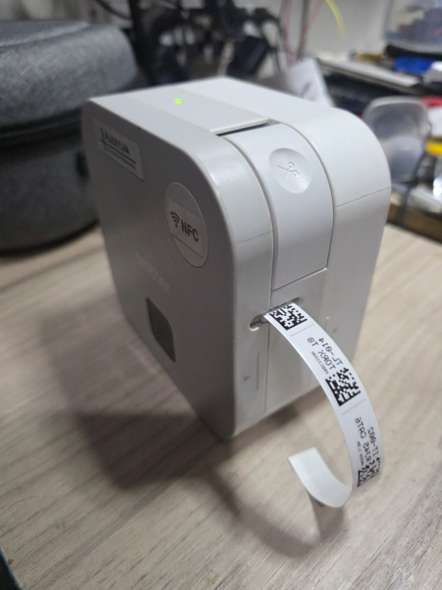

# CubeTag64 — 64px Integer-Aligned Inventory Tag Studio & Static URL API for Brother PT-P300BT

**CubeTag64** turns the consumer **Brother P-Touch Cube (PT-P300BT)** (`MBH7BTZ42A-100101` PCB, 180 DPI, 12mm TZe laminated thermal-transfer tape) into a razor-sharp inventory tag printer for **Homebox**, **Snipe-IT**, **Grocy**, and **Shelf**.



## Why CubeTag64?
1. **Zero Anti-Aliasing (Strict Integer Dots)**: Brother's mobile app scales QR/barcodes to non-integer pixel widths across the 64-dot printhead, blurring small codes. CubeTag64 encodes **DataMatrix (`ECC 200`)**, **QR v1 (`21×21`)**, and **Code 128B** directly at integer dot multiples (`3×3` or `4×4` physical thermal dots per module) paired with a crisp `5×7` 1-bit bitmap font.
2. **Chain-Print Strips (Solving the 24mm Cutter Waste)**: Because the manual cutter sits ~24mm past the printhead, single-label printing wastes 2.4 cm of TZe tape per tag. CubeTag64 packs multiple inventory tags into a continuous strip with scissor cut guides.
3. **Web Serial Status Inspector & PackBits (`4D 02`) Driver**: Built-in Bluetooth Serial Console probes the 32-byte `ESC i S` status packet in hex, decodes `Error Info 1` (`status[8]`) and `Error Info 2` (`status[9]`) (*No Media*, *Cutter Jam*, *Weak Batteries*, *Wrong Media*, *Cover Open*), streams TIFF PackBits (`4D 02`) raster data, and waits for the post-print completion status (`status[18] == 0x01`) before closing the port.
4. **CSV Drag-and-Drop & Presets**: Drag and drop CSV exports directly from **Homebox**, **Snipe-IT**, or **Grocy/Shelf** into the Web Studio or pass `--csv inventory.csv` to `cubetag64_cli.py`.
5. **GitHub Pages Static URL Parameter API**: Hosted on GitHub Pages, CubeTag64 accepts query parameters (`?code=...`, `?items=...`, `&action=png|rawimg|py`) and `window.postMessage` so inventory systems can call it like a stateless API with zero backend.

## Python CLI (`cubetag64_cli.py`)

```bash
# Render a Homebox or Snipe-IT CSV export to a 64px 1-bit PNG strip
python cubetag64_cli.py --csv homebox_export.csv --out strip.png

# Print a Snipe-IT CSV export directly over Bluetooth Classic SPP (Outgoing COM port or /dev/rfcomm0)
python cubetag64_cli.py --csv snipeit_export.csv --preset snipeit --port COM5

# Render and print inline batch items
python cubetag64_cli.py --items "IT-001|USB-C PD|100W 2m;TL-014|TORX T8|Precision" --port COM5

# Probe and decode the 32-byte ESC i S status packet without printing
python cubetag64_cli.py --port COM5 --status-only
```

## GitHub Pages URL API Parameters

| Parameter | Values | Example | Description |
| :--- | :--- | :--- | :--- |
| `code`, `title`, `sub` | Strings | `?code=TL-014&title=TORX+T8&sub=Precision` | Generates a single inventory tag from URL parameters. |
| `items` | Semicolon-separated `CODE\|TITLE\|SUB` | `?items=IT-01\|USB-C\|2m;TL-14\|TORX\|T8` | Generates a multi-tag chain strip in a single URL call. |
| `sym` | `datamatrix` \| `qr` \| `code128` | `&sym=datamatrix` | Selects barcode symbology (default: `datamatrix`). |
| `scale` | `auto` \| `2` \| `3` \| `4` \| `5` | `&scale=4` | Locks integer thermal dots per module. |
| `layout` | `side` \| `compact` \| `codeonly` | `&layout=side` | Selects tag layout. |
| `action` | `png` \| `rawimg` \| `py` | `&action=png` | Auto-downloads the 64px PNG (`png`), renders a pure `` (`rawimg`), or downloads `print_p300bt.py` (`py`). |

## Hardware-Verified Protocol Specs (`MBH7BTZ42A-100101` PCB)

* **Transport**: Bluetooth Classic SPP / RFCOMM (`9600` baud, Channel 1).
* **Raster Column Geometry**: 16 bytes (`128` bits) per vertical column — Bits `0..31` (4B) = `0x00` top margin; **Bits `32..95` (8B) = 64 active printhead dots** (`bitPos = 32 + y`); Bits `96..127` (4B) = `0x00` bottom margin.
* **Compression Mode**: **TIFF PackBits (`4D 02`) is mandatory** (`0x5A` for empty 16B column, `0x47 <len_lo> 0x00 <packbits>` for non-empty 16B column).

## License
MIT
